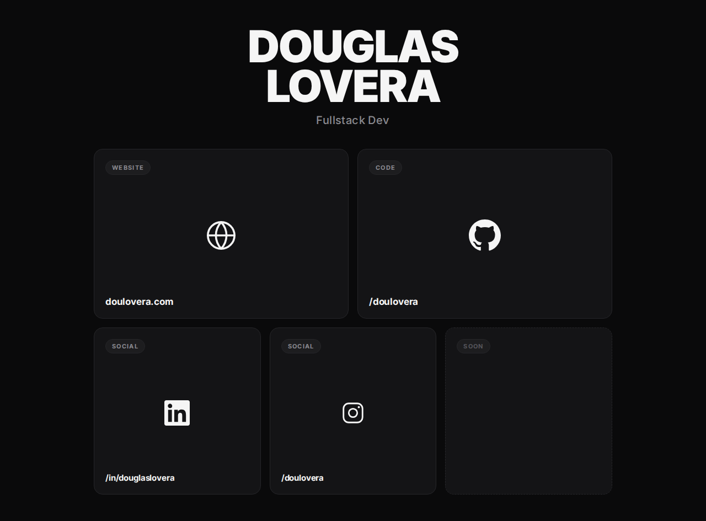

# doulo.dev

The source for [doulo.dev](https://doulo.dev), Douglas Lovera's personal link page.

The site keeps things small and direct: a dark, responsive grid with links to Douglas's website, code, and social profiles. It uses plain HTML and CSS, with inline SVG icons and a dithered color wash on tile hover. There is no JavaScript or frontend framework.

## Preview

[](https://doulo.dev)

[Open doulo.dev](https://doulo.dev)

## Links

- [Website](https://doulovera.com)
- [GitHub](https://github.com/doulovera)
- [LinkedIn](https://www.linkedin.com/in/douglaslovera)
- [Instagram](https://www.instagram.com/doulovera)

## Stack

- HTML and CSS
- Inline SVG icons
- [Cloudflare Workers Static Assets](https://developers.cloudflare.com/workers/static-assets/)
- [Wrangler](https://developers.cloudflare.com/workers/wrangler/)

## Project structure

```text
public/
├── index.html    # Page markup and links
└── styles.css    # Layout, theme, responsive rules, and hover effects
wrangler.jsonc    # Cloudflare deployment configuration
```

## Run locally

Requires Node.js and pnpm.

```bash
pnpm install
pnpm dev
```

Wrangler will start a local server and serve the files in `public/`.

## Deploy

Log in to Cloudflare, then run:

```bash
pnpm deploy
```

The deployment uses `public/` as the static asset directory. Project settings such as the production domain are managed through the Cloudflare project configuration.
